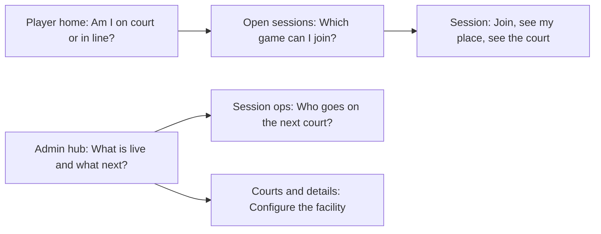

# Player and admin app-screen redesign

## What this is

A **visual and interaction redesign** of the working product (not the marketing homepage). Brand stays as it is today:

- **Type:** DM Sans via `--font-sans` in [app/layout.tsx](app/layout.tsx)
- **Colour:** court green on cream in [app/globals.css](app/globals.css) (`--ground` `#f6f8f2`, `--ink` `#20352a`, `--accent-green` `#39764d`, `--accent-soft` `#eaf3e7`)

No new features, backends, or product phases. Queue RPCs, RLS, realtime invalidation, and copy of real data stay. Selectors that Playwright relies on will be preserved or tests updated.

## Design approach

This is **app-screen work**, not a landing-page restyle. Follow [`.agents/skills/design-taste-frontend/references/app-screens.md`](.agents/skills/design-taste-frontend/references/app-screens.md):

1. Record **before** screenshots (`inspect.mjs --app` into `.taste-skill/before`).
2. Deal one app style with the brand locked:

```bash
node .agents/skills/design-taste-frontend/scripts/draw.mjs --app \
  --kind admin --theme light --keep palette,type \
  --brief "RallyLoop facility queue and court rotation" \
  --screens overview,list,detail,inbox,settings --options 3
```

Then deal the chosen style (likely a quiet light admin style such as `accent-ladder` or `framed-sheet`—pick by how staff work all session, not by familiarity). Map existing tokens onto the sheet’s roles; do not introduce new hues.

3. **Face of the product:** the live queue-to-court rotation (people in line, who is on court), not KPI tiles with icons in tinted circles.
4. Gate with `lint.mjs --app` and `inspect.mjs --app`, then browser-verify each flow.

### UX laws applied on purpose

| Law | How it shows up |
| --- | --- |
| **One job per screen** | Each view answers one question first (below). |
| **Fitts** | Primary action is large, labelled, and on phone sits in the thumb zone (not only in a far header). Min tap 44px. |
| **Hick** | One filled primary per screen; everything else is a text or outline action. |
| **Proximity** | Queue, court, and match for the same session stay in one block. |
| **Jakob** | Player: personal home + list + detail. Staff: sidebar/workspace + operations. |
| **Feedback** | Status uses a pale tint + the word (`waiting`, `on court`, `open`), never colour alone. Loading/empty/error stay honest. |
| **Progressive disclosure** | Create/edit session and court forms stay in dialogs; lists stay scannable. |
| **Consistency** | Same shell, same status language, same type scale on player and admin. |

Avoid generated-dashboard tells: no icon KPI cards, no greeting+wave, no gradients/glass/shadows at rest, no rainbow charts.

## Each screen’s one question



- **Player home (`/player`)**: “Am I playing, waiting, or do I need to find a game?” Biggest thing: the current session strip (position or court name). Primary action: **Browse open sessions** when idle, **Open session** when live.
- **Open sessions (`/sessions`)**: “Which session can I join?” List of open play with time, place, and one **View session** action.
- **Session (`/sessions/[sessionId]`)**: “Where am I, and what do I do?” Queue position (or join) leads; courts sit beside it on desktop, stacked on phone.
- **Admin hub (`/management/[facilityId]`)**: “What is live at this facility?” Open/paused sessions lead; counts are type, not tiles. Primary: **Open sessions**.
- **Facility sessions / courts / details**: lists and settings; one primary per page (create session, add court, save).
- **Session operations (`/management/.../sessions/[sessionId]`)**: “Who goes on court next?” Queue + assign/start/complete in one operations canvas.

**IA fix (user-friendly, not a new feature):** today an **admin** hitting [`app/player/page.tsx`](app/player/page.tsx) is redirected into `AdminFacilityOverview` and never sees their own court/queue. `/player` will always be the personal court view; facility work stays under `/management/...`. Admins still reach the hub from the sidebar.

## Layout principles (keep tokens, change composition)

- **Shell:** keep [components/layout/app-shell.tsx](components/layout/app-shell.tsx) (desktop sidebar + mobile bottom nav). Recede chrome: active nav is a pale green fill, not a loud pill. Product mark + RallyLoop stay. Bottom nav: 3–5 items max, labels that match the job (“My court”, “Sessions”, “Facility”).
- **Player density:** phone-first. Title ~24px. The queue **number** is the large figure. No 4-KPI row.
- **Staff density:** desktop/tablet. Title row + finding line (“2 courts free, 5 waiting”). Rows ~44–52px, tabular figures, one status mark per row.
- **Surfaces:** white on `--ground`, 1px `--border-color` or one tone step—no rest shadows, no glass.
- **Colour budget:** green on the one primary button, live/open status, and the current-player row. Warning/occupied stay `--warning`; errors stay `--negative`.

## Files to change (behaviour kept)

**Shell and tokens**

- [components/layout/app-shell.tsx](components/layout/app-shell.tsx)
- [app/globals.css](app/globals.css) — layout CSS for `.player-*`, `.facility-hub*`, `.admin-home*`, `.session-*`, `.management-*`; token values stay

**Player journey**

- [app/player/page.tsx](app/player/page.tsx) — always player view; drop admin hijack
- [components/player/active-sessions.tsx](components/player/active-sessions.tsx)
- [components/matches/match-history.tsx](components/matches/match-history.tsx)
- [app/sessions/page.tsx](app/sessions/page.tsx)
- [app/sessions/[sessionId]/page.tsx](app/sessions/[sessionId]/page.tsx)
- [components/queue/queue-panel.tsx](components/queue/queue-panel.tsx)

**Admin / staff journey**

- [components/facilities/facility-hub.tsx](components/facilities/facility-hub.tsx)
- [components/facilities/admin-overview.tsx](components/facilities/admin-overview.tsx) — retire from `/player` or reduce to unused
- [components/facilities/facility-setup.tsx](components/facilities/facility-setup.tsx)
- [components/matches/match-manager.tsx](components/matches/match-manager.tsx)
- Management routes under [app/management/[facilityId]/](app/management/[facilityId]/)

Auth pages and [app/page.tsx](app/page.tsx) marketing are **out of scope**.

## Implementation order

1. **Art direction** — deal style, write each screen’s question, map brand tokens, choose the queue-to-court signature.
2. **Shared shell** — nav labels, active states, title row, 44px targets, focus rings (existing 3px green outline stays).
3. **Player journey** — home → browse → live session (biggest UX win for court-side phones).
4. **Admin journey** — hub → session list → live operations → courts/details.
5. **States** — empty, loading, error, assigned vs waiting, for every block touched.
6. **Gate and verify** — inspect before/after; click through join/leave, assign, start/complete, session create; desktop 1440 and phone 390.

## Validation

- `npm run lint`, `npx tsc --noEmit` after UI changes
- Narrow Playwright/Vitest updates if labels or `/player` admin routing change
- Browser pass on player join/queue and staff assign/complete
- Taste inspect: 0 FAIL at 1440 / 768 / 390 on representative screens

## Out of scope

- Phase 7 deployment, new sports/features, dark mode, new fonts, new colour system, marketing restyle

## Screen behavior and content

Keep existing server queries, actions, authorization, and mutation semantics. This section defines presentation and navigation only; if the current data cannot support a display detail, omit that detail instead of inventing a field or fallback.

### Player home (`/player`)

- Resolve the signed-in player's active queue and match state using the existing authoritative query.
- When waiting, lead with the session name and queue position. Include a short explanation that position can change as the queue advances, and link to the session.
- When assigned or playing, lead with the court and match state, then link to the session for current details.
- When the player has no active session, show a direct **Browse open sessions** action and recent match history below it.
- If more than one active session is possible, show each as a compact row with its own status and session link; do not merge positions across sessions.
- Keep administrative navigation available to authorized staff, but do not replace this personal view with the facility overview.

### Open sessions (`/sessions`)

- Show only sessions the existing query considers available to browse, with sport, facility, local date/time, and open/paused state where present.
- Make the session name the row heading. Keep the row's action singular: **View session**.
- Explain an empty result with a next step such as refreshing later or checking another facility if the existing product supports that choice.
- Preserve current filtering and query parameters; do not add new filters as part of the restyle.

### Session detail (`/sessions/[sessionId]`)

- Put the player's own state first: **Join queue**, waiting position, assigned court, or a clear reason the action is unavailable based on existing session/queue state.
- Present queue and court information as adjacent sections on wide screens and in that order on narrow screens.
- Queue rows expose only the public display information already approved by the product. Never add email, private profile data, or staff-only notes.
- Keep leave-queue confirmation and error handling intact. Disable repeat submissions while a mutation is pending and refresh from authoritative data after success.
- For closed or paused sessions, state the status in text and explain whether joining is unavailable; never imply the player is queued when they are not.

### Facility hub and setup

- The hub opens with the live/open session list and a compact operational summary derived from existing counts.
- Keep links to sessions, courts, and facility details visible as secondary navigation. Do not represent totals as decorative KPI tiles.
- Session and court lists use consistent rows: name, relevant date/status, and one clear open/manage action.
- Preserve existing create/edit dialogs, validation, permission checks, and destructive-action confirmations.
- Keep form errors adjacent to their fields and provide a visible save result. Closing a dialog must not silently discard in-progress values.

### Live session operations

- Keep the waiting queue, available courts, and active matches in one workspace, grouped by session.
- Make the next eligible group and available court easy to identify before the existing assignment confirmation.
- Display the match lifecycle as text: assigned, in progress, completed, or cancelled, using existing states only.
- Place start, complete, and cancel actions with the relevant match or court. Keep reason fields and confirmation steps required by current operations.
- After an operation, show the server result and refresh the authoritative session data. Realtime events may prompt a refresh but must not be displayed as authoritative match or staff-note content.

## State and interaction requirements

| State | Required presentation |
| --- | --- |
| Loading | Keep the page structure stable and label the region as loading; avoid placeholder counts that could be mistaken for live values. |
| Empty | Say what is empty and give one relevant next action when one exists. |
| Error | Keep the relevant content area visible, explain that data did not load or the action failed, and offer the existing retry path. |
| Pending action | Disable duplicate submission, retain the action label with a clear progress cue, and keep keyboard focus stable. |
| Success | Confirm the completed action in text and show refreshed server-backed state. |
| Stale/reconnected | Reload through existing queries; never infer the final state solely from an event payload. |
| Unavailable action | Explain the current session or permission condition in text; do not rely on a disabled control without context. |

All controls must have accessible names, visible keyboard focus, and at least a 44px target where practical. Status must have a readable word in addition to any colour treatment. Preserve reduced-motion preferences and avoid adding motion that delays a staff action.

## Acceptance criteria

- An administrator visiting `/player` sees their personal queue/match view and can reach facility work through the management navigation.
- A player can browse a session, understand their own queue/match state, and use the existing join/leave behavior without a change to the underlying operation.
- Staff can reach the live session workspace and complete the existing assign/start/complete flow with the same authorization and confirmations.
- Session, court, and facility forms retain their current validation and permissions.
- Loading, empty, error, pending, and success states are present for each changed data/action block.
- At 390px, player actions remain reachable without horizontal scrolling; at 768px and 1440px, staff queue/court relationships remain clear.
- Keyboard-only navigation reaches every action in a logical order, and status does not depend on colour alone.
- No new data fields, backend services, database changes, or product phases are introduced by the redesign.

## Handoff notes

- Record the selected app-screen style and token mapping in `.taste-skill/notes.md`; keep the source direction output in `.taste-skill/direction.json`.
- Capture before and after screenshots for the same representative routes and viewport sizes. Do not replace prior user screenshots or notes without inspecting them first.
- If a selector used by Playwright must change, update the corresponding test in the same focused change and retain a user-facing accessible label.
- Mark a todo complete only after its screens have been implemented and checked. Report skipped routes, unavailable test accounts, and any manual verification that remains.

## Implementation progress (2026-10-30)

- The shell, player journey, and staff/admin journey have been restyled with the locked RallyLoop palette and DM Sans. Queue, match, and facility mutations remain on their existing server actions and queries.
- `npx tsc --noEmit`, focused ESLint on changed UI/routes, and `npm run build` pass.
- `npm run lint` still reports three hook-rule errors in bundled `.agents/skills/design-taste-frontend/scripts/assets.mjs`; they are outside the application files changed for this redesign.
- Playwright E2E: 2 public tests pass; 8 authenticated journeys skip because isolated test accounts/project variables are unavailable. Anonymous viewport review covers session discovery and details at 1440px, 768px, and 390px without horizontal overflow.
- The taste inspector could not attach to its browser (`CDP timeout: Page.enable`), so the inspector-based baseline/score pass remains incomplete. Saved Playwright screenshots are in `.taste-skill/after/`; rerun the inspector when its browser connection is available.
